

# LAPORAN TUGAS 2

## KLASIFIKASI LESI KULIT MPOX
## MENGGUNAKAN SIMPLE CNN

 

  

**Mata Kuliah: Infrastruktur dan Platform Sains Data (IPSD)**

### DISUSUN OLEH:

| No. | Nama | NIM |
|:---:|---|:---:|
| 1 | Azizta Dwi Rosyiida Putri | 109102500005 |
| 2 | Dina Fithratul Khilma | 109102500008 |
| 3 | Yuwan Sakti | 109102500018 |
| 4 | Putri Vania Tiara Puspita | 109102500027 |
| 5 | Dini Fajrina Uyun Nurjanainah | 109102500032 |

  

**PROGRAM STUDI SAINS DATA**

**TELKOM UNIVERSITY PURWOKERTO**

**2026**

# BAB I – PENDAHULUAN

## 1.1 Latar Belakang

Perkembangan teknologi kecerdasan buatan (Artificial Intelligence) dapat dimanfaatkan dalam bidang kesehatan, salah satunya untuk membantu mengenali penyakit melalui gambar.

Salah satu permasalahan kesehatan yang menjadi perhatian adalah Mpox atau cacar monyet. Pengenalan kondisi kulit sejak awal diperlukan untuk membantu proses penyaringan awal, terutama karena jumlah tenaga ahli kulit masih terbatas.

Pada praktikum ini, dilakukan pembuatan model klasifikasi gambar menggunakan metode **Convolutional Neural Network (CNN)**. Model digunakan untuk mengenali jenis kondisi kulit berdasarkan foto lesi kulit ke dalam enam kelas, yaitu Mpox, Chickenpox, Measles, Cowpox, HFMD, dan Healthy.

Model dilatih dan diuji menggunakan dataset Mpox Skin Lesion Dataset v2.0 (MSLD v2.0). Pengujian dilakukan dengan menggunakan data augmentasi dan tanpa data augmentasi untuk mengetahui pengaruh augmentasi terhadap hasil klasifikasi.

Melalui praktikum ini, diharapkan dapat diketahui kemampuan model Simple CNN dalam mengklasifikasikan gambar lesi kulit. Model ini digunakan sebagai alat bantu penyaringan awal dan bukan sebagai pengganti diagnosis dokter.

## 1.2 Tujuan Praktikum

Tujuan dari praktikum ini adalah:

1. Memahami penerapan metode Convolutional Neural Network (CNN) untuk klasifikasi gambar lesi kulit.
2. Membuat dan melatih model Simple CNN untuk mengklasifikasikan enam kelas kondisi kulit.
3. Melakukan pengujian model menggunakan lima fold dataset.
4. Mengevaluasi performa model menggunakan confusion matrix, accuracy, precision, recall, F1-score, dan ROC-AUC.
5. Membandingkan hasil klasifikasi menggunakan data augmentasi dan tanpa data augmentasi.
6. Mengetahui kemampuan serta keterbatasan model dalam melakukan klasifikasi gambar lesi kulit.

---

# BAB II – DATASET DAN METODE

## 2.1 Dataset yang Digunakan

Dataset yang digunakan dalam praktikum ini adalah **Mpox Skin Lesion Dataset v2.0 (MSLD v2.0)** yang diperoleh melalui Kaggle.

Dataset terdiri dari enam kelas gambar kondisi kulit, yaitu:

1. Mpox
2. Chickenpox
3. Measles
4. Cowpox
5. HFMD
6. Healthy

Dataset memiliki 755 foto asli dari 541 pasien dan telah dibagi menjadi lima fold.

## 2.2 Pembagian Dataset

Dataset dibagi menjadi tiga bagian, yaitu:

1. **Train:** Digunakan untuk melatih model CNN.
2. **Valid:** Digunakan untuk memantau proses pelatihan dan memilih model terbaik.
3. **Test:** Digunakan untuk menguji performa akhir model.

Pengujian dilakukan pada kelima fold dengan menggunakan pasangan data dari fold yang sama.

## 2.3 Metode yang Digunakan

Metode yang digunakan adalah **Convolutional Neural Network (CNN)** dengan arsitektur Simple CNN. Metode ini digunakan untuk mengenali pola pada gambar, seperti bentuk, tekstur, dan karakteristik visual lesi kulit.

Model dibangun menggunakan PyTorch dan dilatih untuk mengklasifikasikan gambar ke dalam enam kelas kondisi kulit.

## 2.4 Penggunaan Data Augmentasi

Pada praktikum ini dilakukan dua percobaan, yaitu:

1. **Dengan augmentasi:** Menggunakan gambar original dan gambar tambahan hasil augmentasi sebagai data pelatihan.
2. **Tanpa augmentasi:** Hanya menggunakan gambar original sebagai data pelatihan.

Kedua percobaan dilakukan pada lima fold untuk mengetahui pengaruh augmentasi terhadap performa model.

## 2.5 Konfigurasi Pelatihan

Konfigurasi yang digunakan dalam proses pelatihan model adalah sebagai berikut:

| Parameter | Nilai |
|---|---|
| Ukuran gambar | 100 × 100 piksel |
| Batch size | 32 |
| Epoch | 20 |
| Learning rate | 0.0001 |
| Optimizer | Adam |
| Loss function | CrossEntropyLoss |
| Jumlah kelas | 6 |
| Jumlah fold | 5 |

---

# BAB III – HASIL PENGUJIAN

## 3.1 Hasil Pelatihan dengan Data Augmentasi

Pelatihan model dilakukan menggunakan data augmentasi pada lima fold. Setiap fold dilatih selama 20 epoch menggunakan arsitektur Simple CNN. Hasil pelatihan kemudian diuji menggunakan data test dari fold yang sama.

Hasil pengujian dengan data augmentasi ditampilkan pada tabel berikut.

| Fold | Accuracy | Precision | Recall | F1-Score | ROC-AUC |
|:---:|---:|---:|---:|---:|---:|
| 1 | 52,70% | 47,91% | 52,70% | 46,35% | 79,53% |
| 2 | 50,00% | 44,03% | 50,00% | 45,72% | 76,37% |
| 3 | 46,88% | 47,38% | 46,88% | 45,88% | 72,64% |
| 4 | 46,91% | 40,04% | 46,91% | 39,95% | 73,99% |
| 5 | 44,44% | 40,68% | 44,44% | 39,66% | 79,11% |
| **Rata-rata** | **48,19%** | **44,01%** | **48,19%** | **43,51%** | **76,33%** |

#### Grafik Training

Grafik berikut menunjukkan proses training dan validasi model pada setiap fold.

**Grafik Training Fold 1**

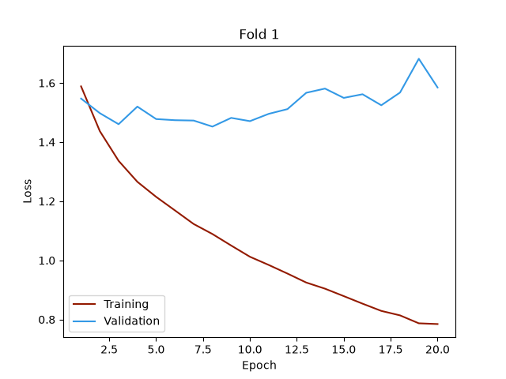

**Grafik Training Fold 2**

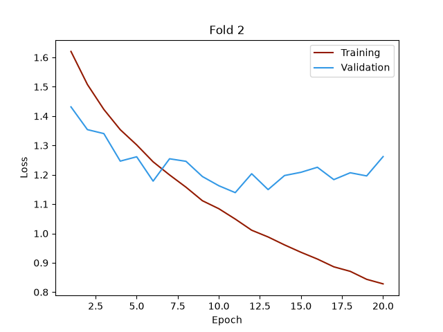

**Grafik Training Fold 3**

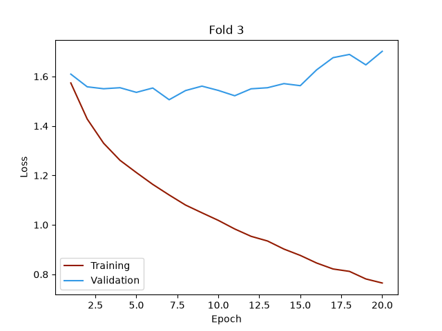

**Grafik Training Fold 4**

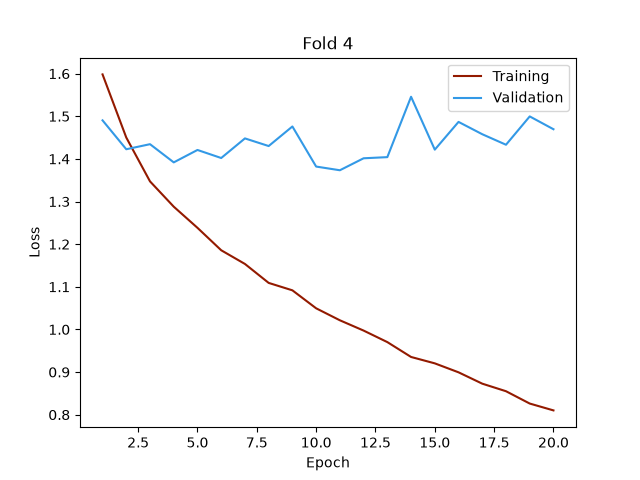

**Grafik Training Fold 5**

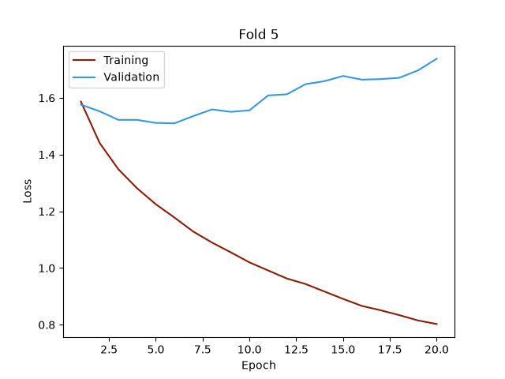

#### Confusion Matrix

Confusion matrix berikut menunjukkan hasil prediksi model pada setiap fold.

**Fold 1**

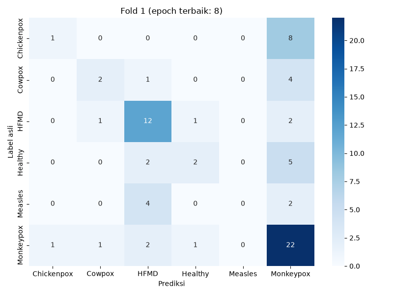

**Fold 2**

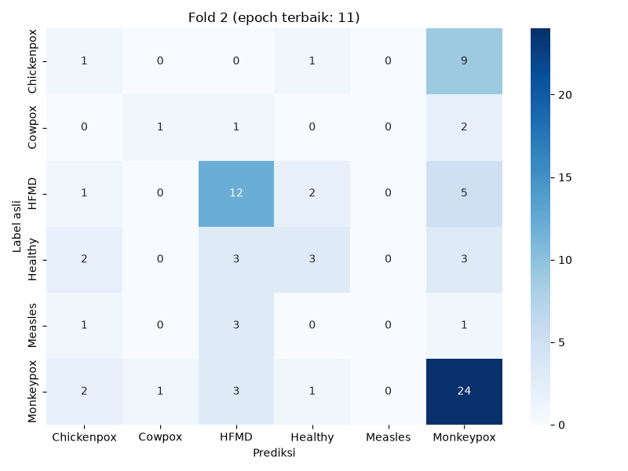

**Fold 3**

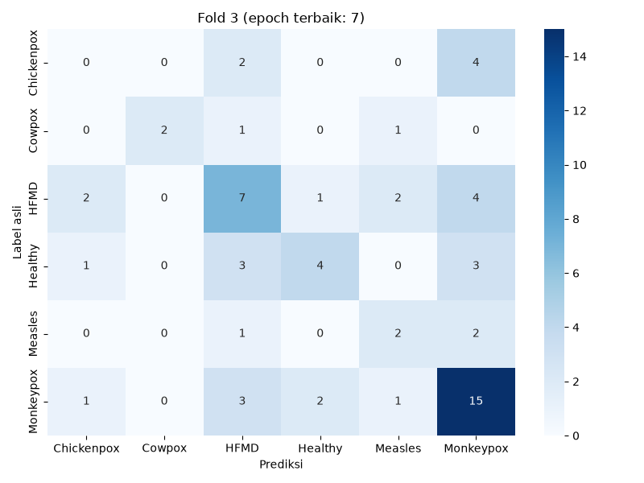

**Fold 4**

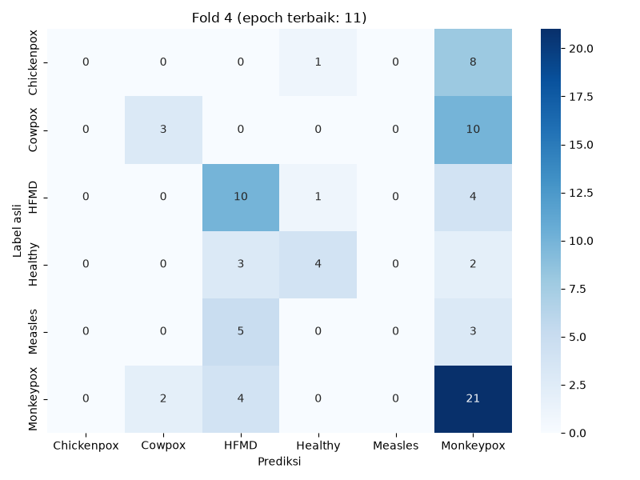

**Fold 5**

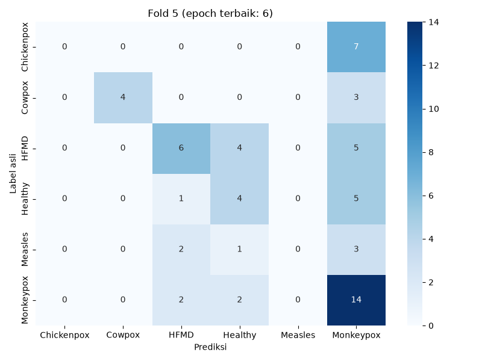

## 3.2 Hasil Pelatihan Tanpa Data Augmentasi

Pengujian berikutnya dilakukan tanpa menggunakan data augmentasi. Model hanya dilatih menggunakan gambar original pada masing-masing fold. Proses pelatihan dan pengujian menggunakan konfigurasi yang sama dengan percobaan sebelumnya.

Hasil pengujian tanpa data augmentasi ditampilkan pada tabel berikut.

| Fold | Accuracy | Precision | Recall | F1-Score | ROC-AUC |
|:---:|---:|---:|---:|---:|---:|
| 1 | 45,95% | 32,23% | 45,95% | 34,52% | 74,14% |
| 2 | 46,34% | 39,12% | 46,34% | 38,19% | 77,97% |
| 3 | 37,50% | 34,96% | 37,50% | 29,20% | 66,84% |
| 4 | 39,51% | 24,31% | 39,51% | 29,83% | 70,21% |
| 5 | 36,51% | 40,15% | 36,51% | 27,95% | 75,29% |
| **Rata-rata** | **41,16%** | **34,15%** | **41,16%** | **31,94%** | **72,89%** |

#### Grafik Training

Grafik berikut menunjukkan proses training dan validasi model tanpa menggunakan data augmentasi.

**Grafik Training Fold 1**

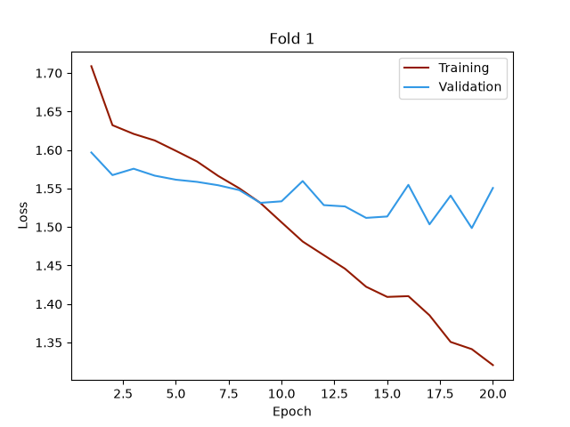

**Grafik Training Fold 2**

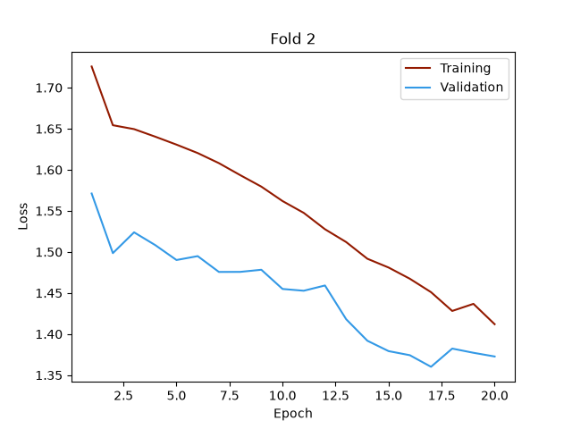

**Grafik Training Fold 3**

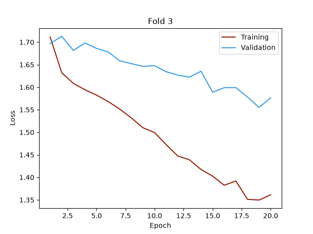

**Grafik Training Fold 4**

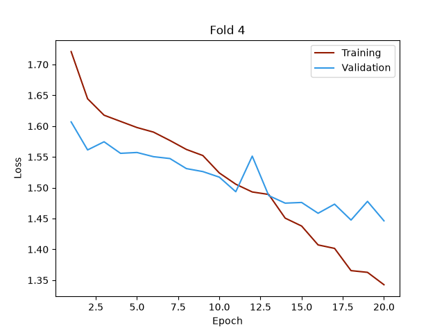

**Grafik Training Fold 5**

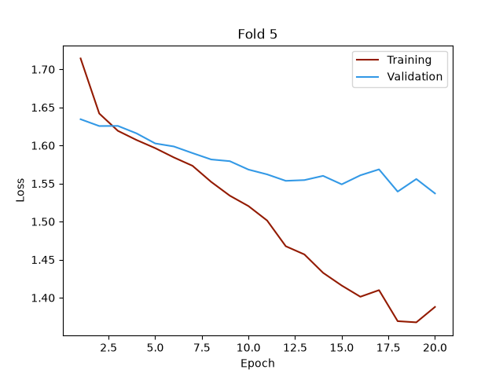

#### Confusion Matrix

Confusion matrix berikut menunjukkan hasil prediksi model tanpa data augmentasi pada setiap fold.

**Fold 1**

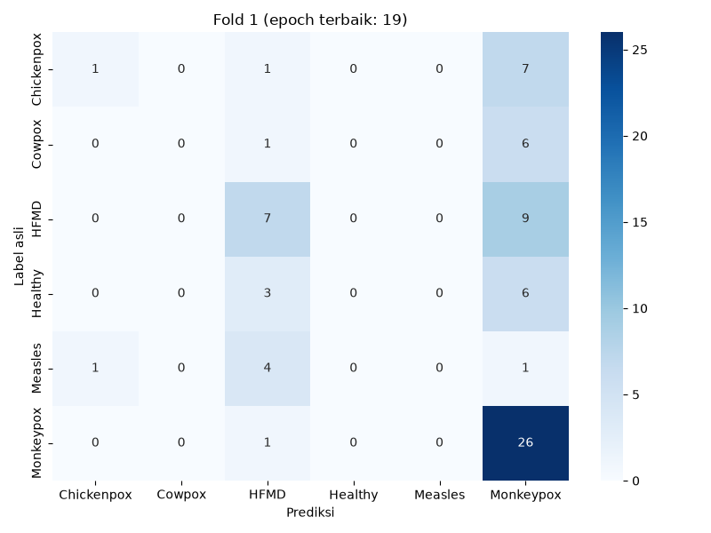

**Fold 2**

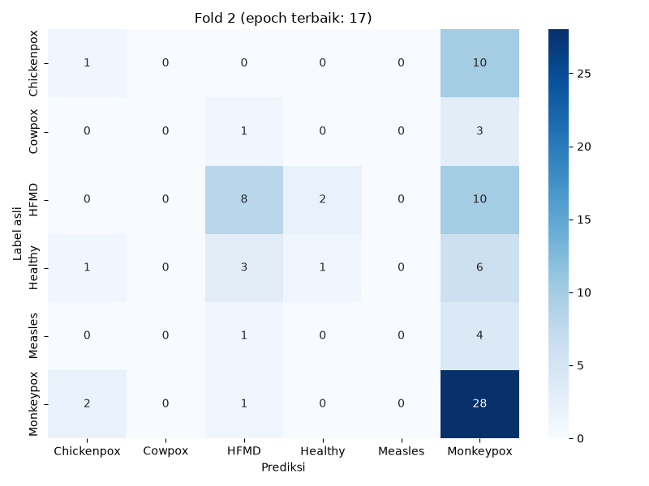

**Fold 3**

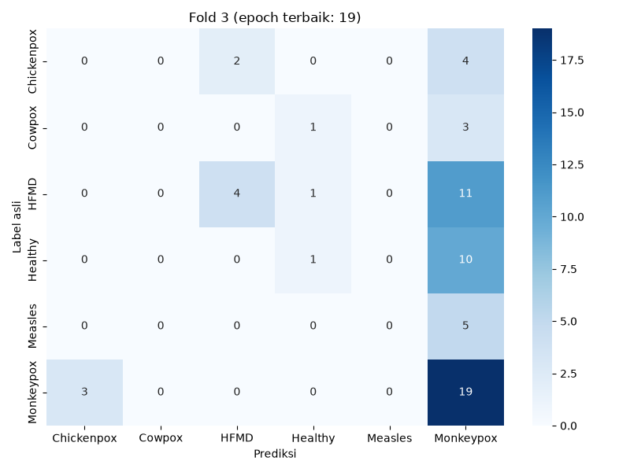

**Fold 4**

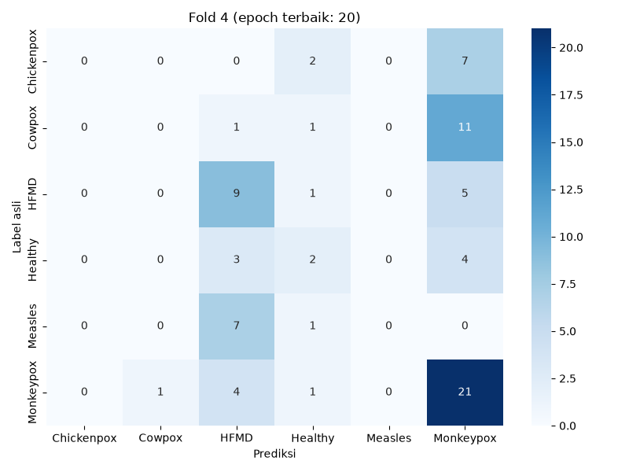

**Fold 5**

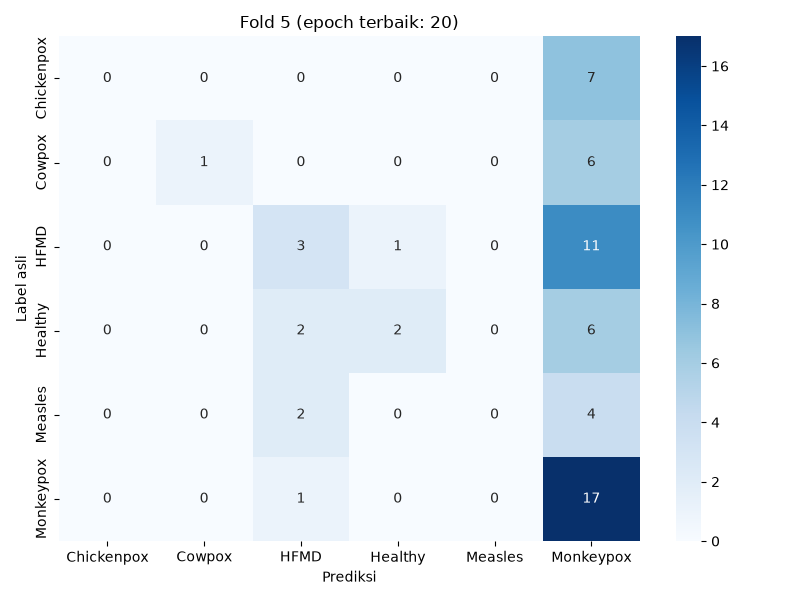

## 3.3 Perbandingan Hasil Pengujian

Berdasarkan hasil pengujian dari kedua percobaan, diperoleh perbandingan nilai rata-rata sebagai berikut.

| Metrik | Dengan Augmentasi | Tanpa Augmentasi |
|---|---:|---:|
| Accuracy | 48,19% | 41,16% |
| Precision | 44,01% | 34,15% |
| Recall | 48,19% | 41,16% |
| F1-Score | 43,51% | 31,94% |
| ROC-AUC | 76,33% | 72,89% |

---

# BAB IV – INTERPRETASI HASIL

## 4.1 Pengaruh Data Augmentasi

Berdasarkan hasil pengujian, penggunaan data augmentasi memberikan peningkatan performa model dibandingkan tanpa augmentasi. Nilai rata-rata accuracy meningkat dari 41,16% menjadi 48,19%. Precision meningkat dari 34,15% menjadi 44,01%, F1-score dari 31,94% menjadi 43,51%, dan ROC-AUC dari 72,89% menjadi 76,33%.

Dengan demikian, data augmentasi membantu meningkatkan kemampuan model dalam melakukan klasifikasi gambar lesi kulit pada percobaan ini.

## 4.2 Kelas yang Paling Sering Salah Diklasifikasikan

Berdasarkan confusion matrix, pada percobaan dengan augmentasi, kelas Chickenpox merupakan kelas yang paling sering salah diklasifikasikan. Kelas ini paling sering tertukar dengan Monkeypox.

Sementara itu, pada percobaan tanpa augmentasi, kelas HFMD merupakan kelas yang paling sering salah diklasifikasikan dan paling sering tertukar dengan Monkeypox.

Kesalahan tersebut kemungkinan terjadi karena beberapa kondisi kulit memiliki bentuk dan tampilan lesi yang mirip, sehingga model kesulitan membedakan karakteristik setiap kelas.

## 4.3 Recall Kelas Monkeypox

Rata-rata recall kelas Monkeypox pada percobaan dengan augmentasi adalah sekitar 76,53%, sedangkan tanpa augmentasi sekitar 89,04%.

Recall penting untuk penyakit menular karena menunjukkan kemampuan model dalam mengenali kasus yang benar-benar termasuk kelas Monkeypox. Nilai recall yang tinggi dapat membantu mengurangi jumlah kasus Monkeypox yang salah diprediksi sebagai kelas lain.

Namun, model ini tetap hanya digunakan sebagai alat bantu penyaringan awal dan bukan sebagai pengganti diagnosis dokter.

## 4.4 Penyebab Kesalahan Klasifikasi dan Cara Memperbaikinya

Model masih sering melakukan kesalahan klasifikasi karena jumlah data gambar yang terbatas dan adanya kemiripan karakteristik visual antara beberapa jenis lesi kulit. Hal tersebut membuat model kesulitan mengenali perbedaan setiap kelas secara tepat.

Salah satu cara untuk memperbaikinya adalah menambah jumlah dan variasi gambar pada setiap kelas agar model dapat mempelajari lebih banyak karakteristik lesi kulit. Selain itu, kualitas dan keseimbangan data juga perlu diperhatikan agar hasil klasifikasi dapat meningkat.

---

# BAB V – KESIMPULAN

## 5.1 Kesimpulan

Berdasarkan praktikum klasifikasi lesi kulit menggunakan metode Simple CNN, dapat disimpulkan bahwa:

1. Model Simple CNN berhasil digunakan untuk melakukan klasifikasi gambar ke dalam enam kelas kondisi kulit, yaitu Mpox, Chickenpox, Measles, Cowpox, HFMD, dan Healthy.
2. Pengujian dilakukan menggunakan lima fold dengan dua percobaan, yaitu menggunakan data augmentasi dan tanpa data augmentasi.
3. Penggunaan data augmentasi memberikan hasil rata-rata yang lebih baik pada sebagian besar metrik. Accuracy meningkat dari 41,16% menjadi 48,19%, precision dari 34,15% menjadi 44,01%, F1-score dari 31,94% menjadi 43,51%, dan ROC-AUC dari 72,89% menjadi 76,33%.
4. Meskipun demikian, recall kelas Monkeypox tanpa augmentasi lebih tinggi, yaitu 89,04%, dibandingkan dengan augmentasi sebesar 76,53%.
5. Model masih memiliki keterbatasan dalam membedakan beberapa kelas yang memiliki kemiripan tampilan lesi kulit. Oleh karena itu, model masih dapat dikembangkan agar menghasilkan klasifikasi yang lebih baik.

Secara keseluruhan, data augmentasi membantu meningkatkan performa model pada sebagian besar metrik pengujian. Namun, model Simple CNN ini masih perlu dikembangkan dan hanya digunakan sebagai alat bantu penyaringan awal, bukan sebagai pengganti diagnosis tenaga medis.

---

---

# TAUTAN PENDUKUNG

## 1. Dataset

Dataset yang digunakan dalam praktikum ini adalah Mpox Skin Lesion Dataset v2.0 (MSLD v2.0) yang diperoleh dari Kaggle.

[Mpox Skin Lesion Dataset v2.0 – Kaggle](https://www.kaggle.com/datasets/joydippaul/mpox-skin-lesion-dataset-version-20-msld-v20)

## 2. Video Praktikum

**Link YouTube:** https://youtu.be/E3ybLMaj3RU?si=RiNovUQm8gvnERPz